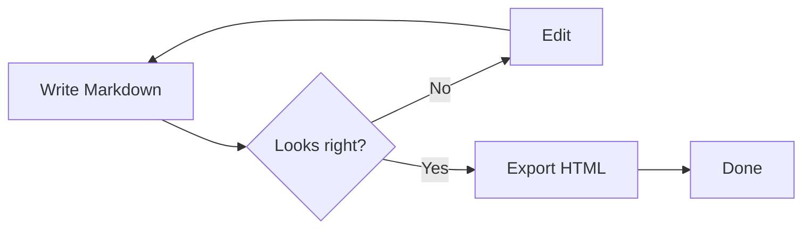

# MDView — a calm place to write Markdown

MDView renders your Markdown as you type. Write on the left, watch it take shape on the right, then export a clean, self-contained HTML file when you're done.

> **Tip** — everything here is editable. Change a line and the preview updates almost immediately.

---

## Getting started

1. Type Markdown in the left pane.
2. Open an existing file with **Open**, or drop a `.md` file anywhere on the page.
3. Export a standalone page with **Export**.

The outline button in the toolbar (or `Ctrl` + `\`) opens a table of contents built from your headings.

### Opening files

You can drag files straight onto the window. Supported extensions are `.md`, `.markdown`, and `.txt`.

### The live preview

Rendering is debounced by about 150 ms, so the preview keeps up while you type without getting in the way.

## Writing guide

### Text formatting

Use **bold**, *italic*, ~~strikethrough~~, and `inline code`. Links look like [this one](https://commonmark.org) and are rendered safely. A single newline stays part of the same paragraph; to start a new line, end a line with two spaces or leave a blank line between paragraphs.

### Lists and tasks

- A simple bullet
- With a nested item
  - and one more level
- Back to the top level

1. Ordered lists work
2. And they keep their numbering
3. Across several lines

- [x] Write something
- [x] Preview it
- [ ] Export it

### Tables

| Feature | Status | Notes |
| :--- | :---: | ---: |
| Live preview | Ready | Debounced |
| Syntax highlighting | Ready | highlight.js |
| Diagrams | Ready | Mermaid |
| Export | Ready | Standalone HTML |

### Code

```js
// Fenced code blocks get a language label and a copy button.
const greeting = (name) => `Hello, ${name}!`;

export function render(items = []) {
  return items
    .filter(Boolean)
    .map(greeting)
    .join("\n");
}
```

```bash
# Shell snippets work too.
npm install --global mdview
mdview ./notes.md --open
```

Inline code sits in a chip, like `const total = price * qty`.

### Diagrams



Diagrams are drawn with Mermaid and re-render when you switch between the light and dark themes.

## Keyboard shortcuts

| Shortcut | Action |
| --- | --- |
| Ctrl / Cmd + O | Open a file |
| Ctrl / Cmd + S | Export HTML |
| Ctrl / Cmd + \\ | Toggle the outline |

## Export

Export writes a single HTML file with your rendered content, the theme colours currently in use, and any diagrams already drawn. There is no build step and nothing to install.
